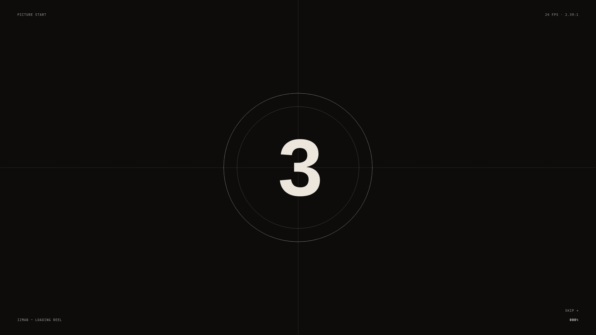

<div align="center">

# 🎬 IZMAB

### Cinematic Filmmaker & Visual Storytelling Showcase

[](https://izmab.vercel.app)
[](https://react.dev/)
[](https://threejs.org/)
[](https://greensock.com/)
<br/>

<p align="center">
  
</p>

[](LICENSE)
[](https://github.com/pouya-wp)

<p align="center">
  <b>IZMAB</b> is a cinematic director and filmmaker visual portfolio. Structured and edited like a feature film, it combines dynamic depth-of-field lens blurs, physical grade comparisons, analog film audio design, and smooth inertial scrolling.
</p>

</div>

---

## ✨ Features

- 🎞️ **Cut-Like-A-Film Narrative** — Editorial pacing where each section behaves like an individual frame sequence.
- 🔍 **Physical Lens Blur & Depth of Field** — Realtime shader-driven optical blur transitioning smoothly as the user explores projects.
- 🎨 **Real-Time Grade Comparator** — Interactive split-screen slider comparing raw camera log footage against finished cinematic color grades.
- 🔊 **Subtle Analog Foley Design** — Tactile UI click sounds, film reel ambient hum, and soft glass tones.
- 📜 **Inertial Momentum Scrolling** — Powered by Lenis for buttery smooth navigation.

---

## 🏗️ Architecture

| Module | Technologies | Responsibility |
|:---|:---|:---|
| `src/components/` | React 19, TypeScript | Film reel sections, pricing calculator, responsive grid |
| `src/three/` | Three.js, GLSL | Custom lens shader, film grain pass, vignette |
| `src/sound/` | Web Audio API | Tactile interface audio feedback and sound design |

---

## 🚀 Quick Start

```bash
# Clone the repository
git clone https://github.com/pouya-wp/izmab.git
cd izmab

# Install dependencies
npm install

# Start local preview
npm run dev
```

---

## 📄 License

Distributed under the MIT License.

---

<div align="center">
  <sub>Crafted with precision & passion by <b><a href="https://github.com/pouya-wp">Pouya Sadeghpour</a></b></sub>
</div>
